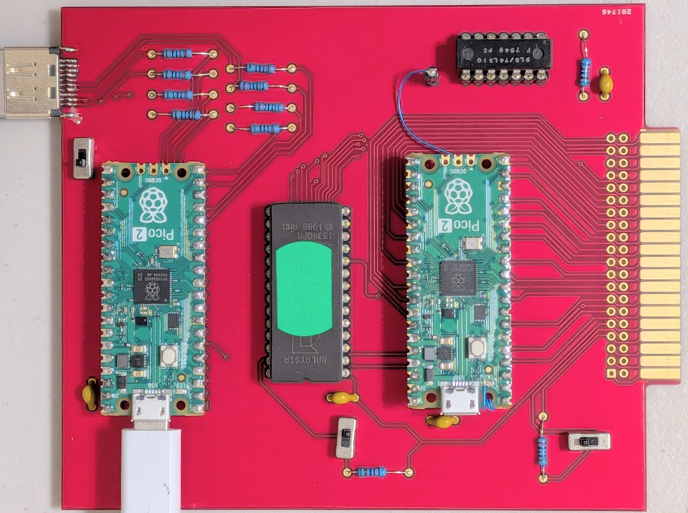
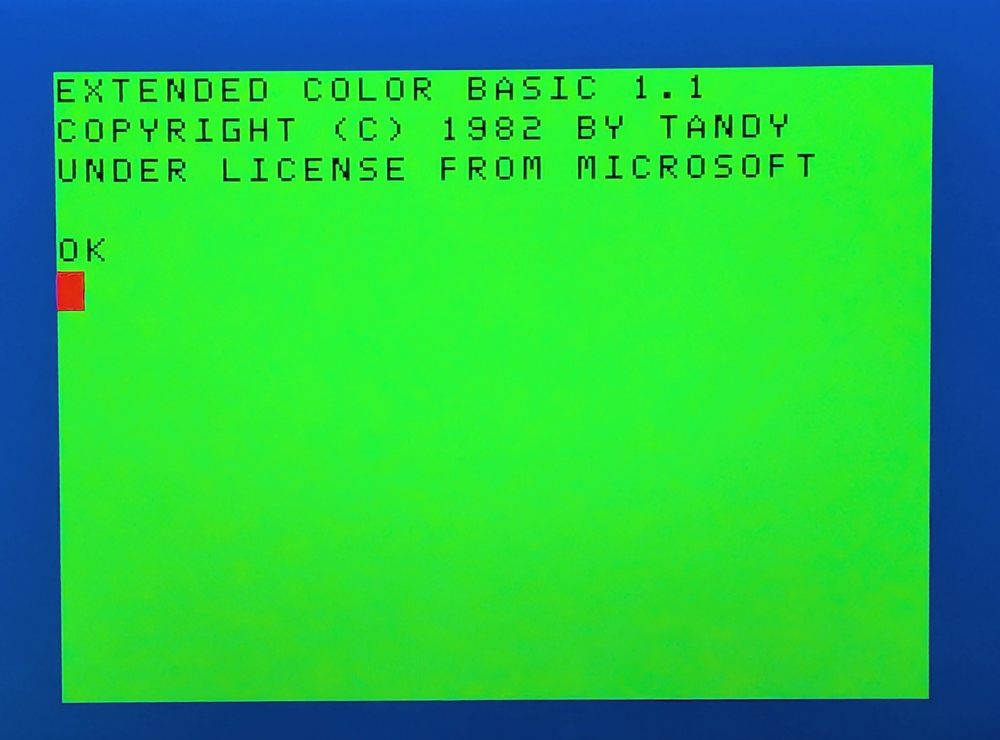
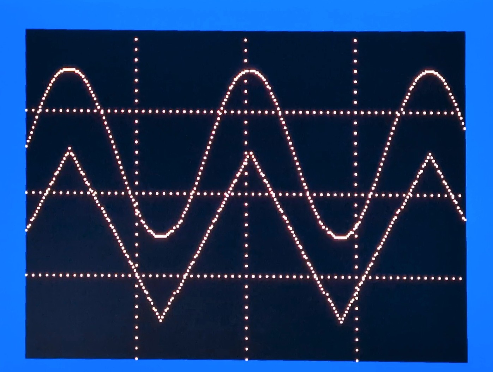

Add DVI to your Tandy Color Computer II by plugging in a ROM like cartridge board. 

Two Raspberry Pi Pico 2 processors and one TTL logic chip do the work.

The board captures all memory writes then sorts the data for transmission.

Received data is translated into 6847 video modes and displayed via a DVI output.

Just drop the UF2 files into the Pico processors and build the card.

Gerber and drill files are supplied if you are interested in exploring this project.

